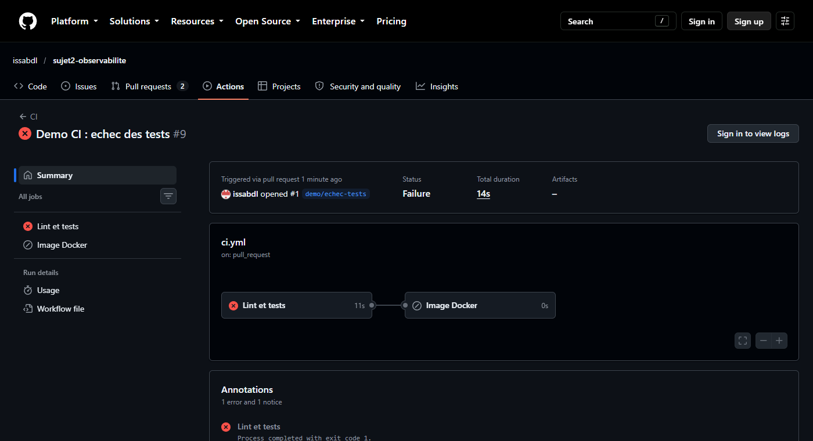
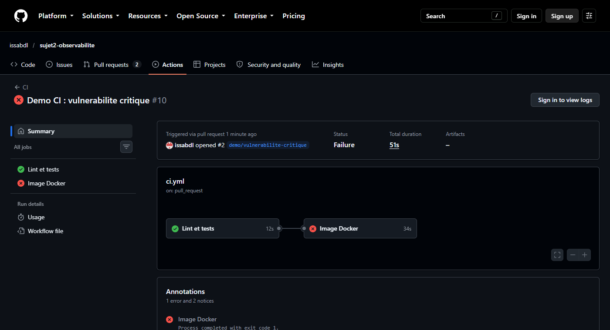
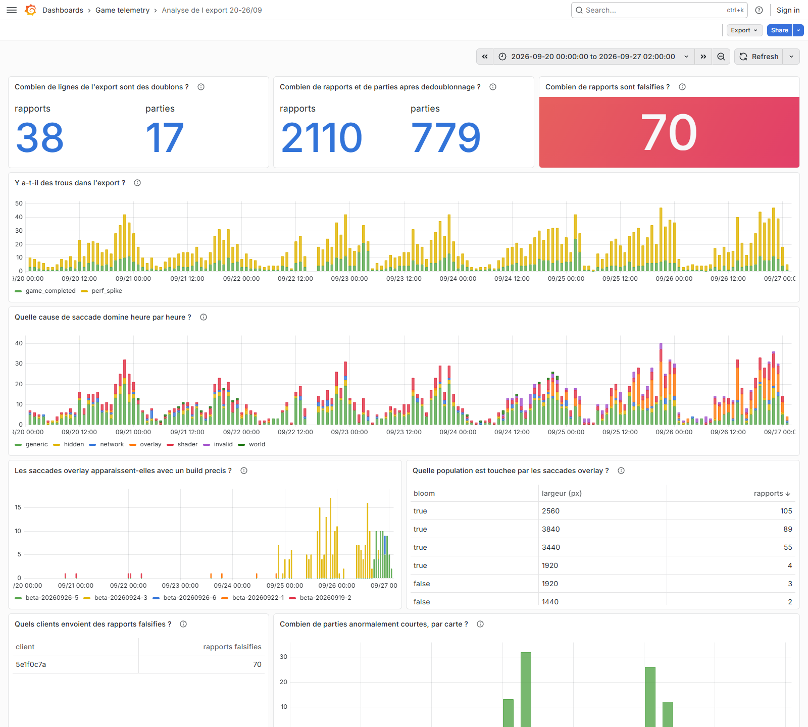
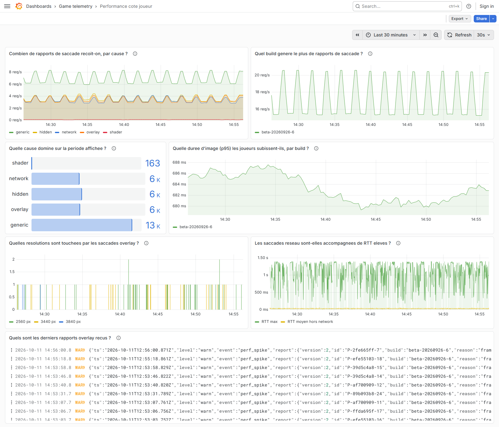
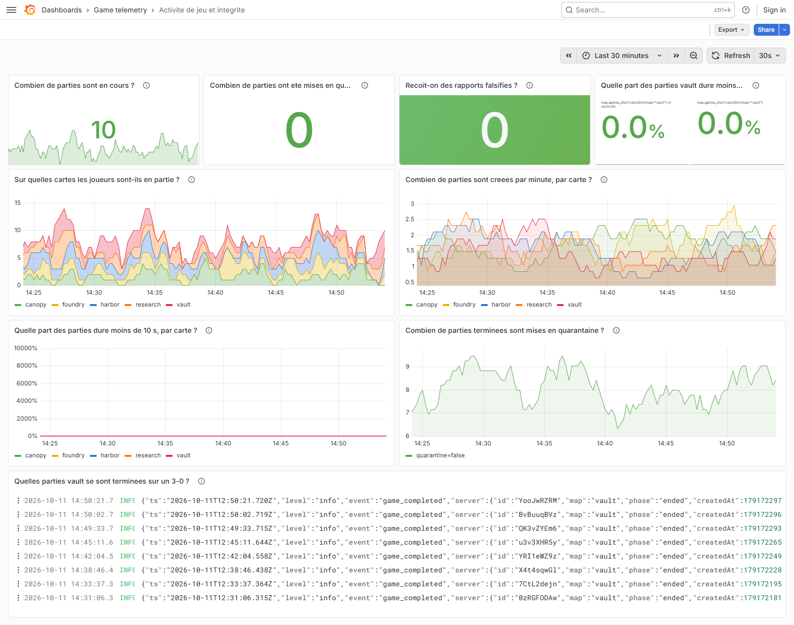
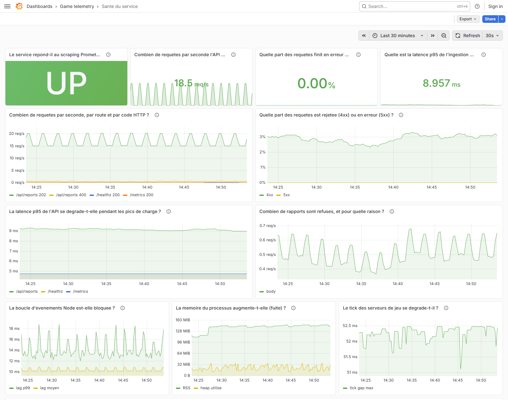
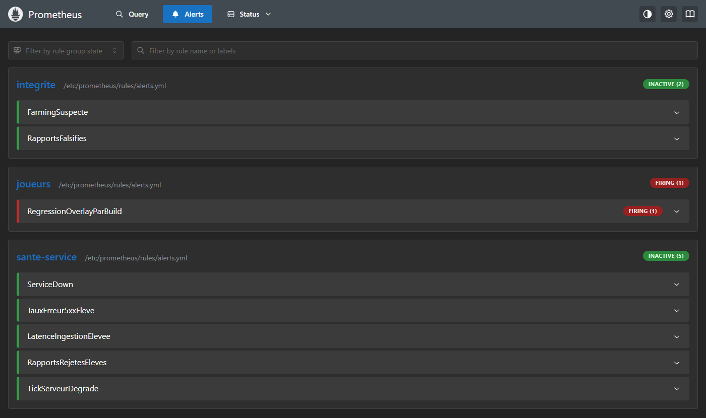
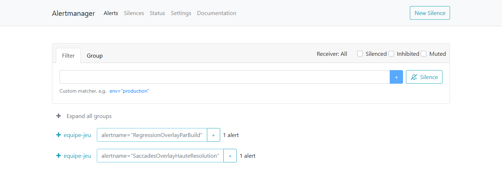

# Observabilité et détection de comportements sur un jeu multijoueur web

UE03 Données et Analytics - Sujet 2

Nom : Issa Abdoulaye

Dépôt : https://github.com/issabdl/sujet2-observabilite

---

## 1. Ce que j'ai mis en place

Le service fourni écrit ses événements en JSON lines dans `logs/telemetry.log`. Je lui ai ajouté une route `/metrics` et j'ai monté toute la stack autour avec Docker Compose, donc `docker compose up -d --build` suffit à tout lancer.

Pour les logs, Alloy lit le fichier du service (il est dans un volume partagé avec l'app) et envoie les lignes dans Loki. L'export historique n'est pas au bon format pour Alloy, donc c'est un petit conteneur `history-import` qui le nettoie et le pousse directement dans Loki au démarrage. Pour les métriques, Prometheus scrape l'app toutes les 15 secondes. Les alertes de Prometheus et celles du ruler de Loki partent toutes les deux vers Alertmanager. Grafana récupère ses datasources et ses dashboards directement depuis le dépôt, il n'y a rien à importer à la main.

```
              logs JSON (fichier)             push
  app ───────────────────────────► alloy ─────────► loki ◄──── history-import
   │                                                  │            (export admin)
   │ /metrics (scrape 15 s)                           │ ruler
   ▼                                                  ▼
prometheus ──── alertes ─────────────────────► alertmanager
   │
   └──────────────► grafana ◄──────────── loki
```

Côté CI, la pipeline GitHub Actions fait le lint et les tests, construit l'image (Dockerfile en deux étapes, image alpine, npm supprimé, utilisateur `node`), la scanne avec Trivy et la publie sur GHCR avec un tag `version-commit`. Les deux cas d'échec demandés sont en annexe A.

---

## 2. Qualité des données de l'export (partie B)

### 2.1 Comment j'ai ingéré l'export

En ouvrant `admin-export-2026-09-20_26.log`, on voit tout de suite que ce n'est pas du JSON lines : chaque événement fait plusieurs lignes, avec un en-tête du genre `Performance spike <serveur> · 9/26/2026, 10:23:04 PM`, une sous-ligne, puis le JSON indenté. Alloy ne peut pas lire ça proprement, alors j'ai écrit un script (`support/scripts/import-history.js`).

Il découpe le fichier en blocs à partir des en-têtes, convertit la date en UTC (j'explique plus bas pourquoi ce n'est pas si simple), parse le JSON et pousse le tout dans Loki avec le label `job="history"`. Au passage il ajoute quelques champs qui m'ont servi pour l'analyse : la cause du rapport (avec le même classifieur que le service), l'id du client que l'on trouve dans l'id du rapport (`P-<client>-<numéro>`), la durée des parties et un RTT unique pour les deux versions du schéma. Je n'ai pas supprimé les doublons, je les ai marqués avec `dup: true`. Comme ça je peux les compter dans Loki, et toutes les autres requêtes filtrent `dup="false"`.

Pour chaque constat, je donne soit une commande sur le fichier brut, soit une requête LogQL. Les requêtes LogQL sont à lancer sur la période du 20 au 26/09, qui est la plage du dashboard « Analyse de l'export ».

### 2.2 Volumétrie

Le fichier fait 6 072 091 octets et 264 344 lignes (`wc -lc`). Il contient 2 148 blocs « Performance spike » et 796 blocs « Game completed » (`grep -c '^Performance spike '` et `grep -c '^Game completed '`). Tous les JSON se parsent sans erreur, et on voit passer 231 clients différents.

Par jour (heure de Paris, sans les doublons) :

| Jour | 20/09 | 21/09 | 22/09 | 23/09 | 24/09 | 25/09 | 26/09 |
|---|---|---|---|---|---|---|---|
| Rapports | 281 | 244 | 242 | 290 | 274 | 413 | 362 |
| Parties terminées | 107 | 96 | 91 | 149 | 105 | 133 | 97 |

Requête : `sum by (event) (count_over_time({job="history"} | json | dup="false" [1d]))`, évaluée à minuit chaque jour. On voit déjà deux choses bizarres, que j'explique dans la partie E : beaucoup plus de rapports le 25 et le 26, et un pic de parties le 23.

### 2.3 Les pièges de format

Le premier piège, c'est que le fichier est à l'envers. Il commence le 27/09 à 00:04 et finit le 20/09 à 00:31, donc du plus récent au plus ancien. Ce n'est même pas parfaitement trié : il y a deux endroits (lignes 67 376 et 129 367) où deux événements sont inversés, à une ou trois secondes près. Mon script retrie tout avant l'envoi. Loki accepte un peu de désordre, mais pas sur une semaine entière dans le même flux.

Ensuite, les heures sont au format américain sur 12 heures (`9/27/2026, 12:04:13 AM`). Il y en a 882 en AM et 2 062 en PM (`grep -oE '(AM|PM)$' ... | sort | uniq -c`). Il faut faire attention à « 12:04 AM », qui veut dire minuit et quatre minutes et pas midi. Les tout premiers blocs du fichier sont justement dans ce cas.

Le piège le plus vicieux, c'est le fuseau horaire, parce qu'il n'est écrit nulle part. J'ai pu le retrouver grâce au champ `createdAt` des parties, qui est un timestamp en millisecondes, donc en UTC. Si on lit l'en-tête comme de l'UTC, toutes les parties durent plus de deux heures, ce qui n'a aucun sens. Si on le lit comme l'heure de Paris (UTC+2 en septembre), les durées tombent entre 54 et 839 secondes, ce qui est cohérent. J'ai donc fait la conversion avec le fuseau `Europe/Paris` plutôt qu'un +2 en dur, pour que ça marche aussi avec un export qui passerait par le changement d'heure. Vérification : `max_over_time({job="history",event="game_completed"} | json | unwrap durationS [$__range])` renvoie 839 s. Au final, l'export « du 20 au 26 » couvre en UTC la période du 19/09 22:31 au 26/09 22:04.

### 2.4 Doublons

55 blocs sont exactement identiques à un bloc déjà vu (même en-tête, même JSON) : 38 rapports et 17 parties. Pour les rapports, l'id est le même aussi, donc c'est bien le même événement exporté deux fois et pas une coïncidence.

```
sum by (event) (count_over_time({job="history"} | json | dup="true" [$__range]))
```

### 2.5 Trous

Une fois les événements triés, j'ai cherché les moments où il ne se passe rien pendant plus de 30 minutes. J'en trouve 60. La plupart (42) sont la nuit, ce qui est normal vu le peu de joueurs. Les 17 autres en journée font entre 30 et 51 minutes, ce qui reste crédible avec une centaine de parties par jour.

Il y en a un qui ne colle pas du tout : le 22/09, rien entre 13:59 et 16:14 (heure de Paris), soit 2 h 15 en plein après-midi. Je pense que ce sont des données perdues et pas juste un creux d'activité, parce que 4 rapports envoyés juste avant appartiennent à des parties dont la fin n'apparaît jamais dans l'export. On le voit bien sur le panneau « Y a-t-il des trous dans l'export ? » (`sum by (event) (count_over_time({job="history"} | json | dup="false" [1h]))`).

### 2.6 Incohérences dans le contenu

Il y a d'abord deux versions du schéma. 25 rapports, tous du build `beta-20260926-6`, sont en version 2 : le RTT y passe de `report.rttMs` à `report.network.rttMs` et une étape `physics` apparaît. Le script ramène le RTT dans un seul champ `rttMs`.

Ensuite, 882 rapports ont `gpuRenderMs` à `null`. Au début je pensais que c'était une erreur, mais ce sont tous des rapports où `gpuTimerSupported` vaut `false` (Safari et Firefox), le navigateur ne fournit simplement pas la mesure. Je les ai laissés tels quels, remplacer par 0 aurait faussé les moyennes.

Plus grave, 70 rapports sont physiquement impossibles (fps au-dessus de 144, étape de rendu négative, durée d'image plus petite que la somme des étapes) et ils viennent tous du même client. J'en parle dans la partie E. Ils sont classés `invalid`.

74 rapports parlent d'un serveur qui n'a jamais de « Game completed ». Ce sont les 70 rapports falsifiés et les 4 rapports d'avant le trou du 22/09.

Enfin, plusieurs builds tournent en même temps : `beta-20260919-2` est encore utilisé le 23/09 alors que `beta-20260922-1` est sorti la veille. Ce n'est pas une erreur, les joueurs reçoivent la mise à jour quand ils se reconnectent, mais il faut y penser quand on compare les builds.

```
sum by (report_version, report_build) (count_over_time({job="history",event="perf_spike"} | json | dup="false" [$__range]))
sum by (report_graphics_gpuTimerSupported) (count_over_time({job="history",event="perf_spike"} | json | dup="false" [$__range]))
```

---

## 3. Métriques et logs (partie C)

### 3.1 Les métriques du service

Elles sont dans `support/src/metrics.js` (prom-client).

| Métrique | Type | Labels | Pourquoi |
|---|---|---|---|
| `http_requests_total` | counter | method, route, status | Débit et taux d'erreur de l'API (R et E de RED). Counter car on fait des `rate()` dessus. |
| `http_request_duration_seconds` | histogram | method, route | Latence (D de RED). Un histogram permet de calculer des percentiles dans Prometheus. Les buckets vont de 5 ms à 1 s parce que l'app répond en quelques ms mais peut bloquer jusqu'à 40 ms sur un gros rapport. |
| `perf_reports_total` | counter | cause, build, source | Les rapports reçus par cause et par build demandés dans le sujet. `source` sépare ceux qui arrivent par l'API de ceux de la simulation. |
| `perf_reports_rejected_total` | counter | reason | Rapports refusés (corps incomplet ou id invalide). On pourrait le déduire des codes HTTP mais la raison est plus parlante. |
| `perf_report_frame_ms` | histogram | build | La durée d'image signalée, c'est ce que le joueur ressent vraiment. Je n'y compte pas les rapports `hidden` (onglet en arrière-plan) ni `invalid` : au début le p95 montait à 5 s à cause d'eux alors qu'aucune image n'était affichée. |
| `games_in_progress` | gauge | map | Parties en cours, ça monte et ça descend donc une gauge. |
| `games_tick_gap_max_ms` | gauge | aucun | Le pire écart entre deux ticks serveur sur les parties en cours, pour voir si les serveurs rament. |
| `games_created_total` | counter | map | Rythme de création des parties. Un pic sur une seule carte peut être du farming. |
| `games_completed_total` | counter | map, quarantined | Parties terminées, et combien partent en quarantaine. |
| `game_duration_seconds` | histogram | map | Durée réelle des parties. Le bucket de 10 s sert à repérer les parties anormalement courtes. |

J'ai aussi gardé les métriques par défaut de prom-client (CPU, mémoire, event loop).

J'ai fait attention à la cardinalité des labels. La route vient du chemin déclaré dans Express et pas de l'URL brute, et tout ce qui est inconnu devient `route="other"`. Sinon n'importe qui pourrait créer une nouvelle série en appelant une URL au hasard. Pareil pour le build, qui est envoyé par le client et dont on ne peut donc pas être sûr : je ne le garde que s'il ressemble à `beta-AAAAMMJJ-n`, sinon il devient `other`. Les autres labels ont très peu de valeurs (7 causes, 5 cartes). L'id du client, l'id de partie ou la résolution ne sont pas des labels, il y en a beaucoup trop et ils changent tout le temps. Ils restent dans les logs.

Un détail qui m'a fait perdre du temps : Prometheus 3 réécrit le label des buckets en `le="10.0"` alors que prom-client envoie `le="10"`. Ma recording rule ne trouvait rien tant que je filtrais sur `"10"`.

### 3.2 Recording rules

| Règle | À quoi elle sert |
|---|---|
| `route_status:http_requests:rate5m` | débit par route et par code, utilisé dans le dashboard santé |
| `route:http_errors:ratio5m` | ratio de 5xx, utilisé par l'alerte `TauxErreur5xxEleve` |
| `route:http_request_duration_seconds:p95_5m` | latence p95, utilisée par l'alerte `LatenceIngestionElevee` |
| `build_cause:perf_reports:rate5m` | rapports par build et par cause, utilisé par l'alerte de régression |
| `build:perf_report_frame_ms:p95_15m` | durée d'image p95 par build |
| `map:games_short:ratio30m` | part des parties de moins de 10 s par carte, utilisé par l'alerte farming |

Elles évitent de recalculer les `histogram_quantile` à chaque rafraîchissement de Grafana, et surtout les dashboards et les alertes affichent exactement le même chiffre.

### 3.3 Les labels dans Loki

Les logs live arrivent avec quatre labels : `job`, `service`, `level` et `event`. Ils ont peu de valeurs possibles (6 événements, 3 niveaux) et servent seulement à choisir le flux, par exemple `{job="game-telemetry", event="perf_spike"}`. Tout le reste (cause, build, client, résolution) est extrait au moment de la requête avec `| json`. Si j'avais mis le client en label, Loki aurait créé un flux par client, ce qu'il gère très mal. J'ai aussi supprimé le label `filename` qu'Alloy ajoute tout seul, vu qu'il n'y a qu'un fichier.

### 3.4 Métriques ou logs ?

Pour moi, les métriques servent à suivre des chiffres dans le temps et à alerter vite pour pas cher : débit, erreurs, latence, nombre de parties, rapports par cause et par build. Ça coûte pareil avec 10 événements ou 10 000, mais on perd le détail de chaque événement.

Les logs servent à comprendre. C'est là qu'on retrouve quel client, quelle résolution, quel navigateur, quelles étapes du rendu ont pris du temps. Toute l'enquête de la partie E (la population touchée, le client qui triche) n'aurait pas été possible avec seulement des métriques, parce que ces informations ne peuvent pas être des labels.

En résumé, la métrique dit « il y a beaucoup de saccades overlay sur tel build », et les logs disent chez qui et pourquoi. Pour l'historique, on n'avait de toute façon que des logs, il n'y avait pas de métriques en production à ce moment-là.

---

## 4. Détection de comportements (partie E)

### 4.1 Typologie des rapports

Pour classer les rapports, j'ai regardé à quoi ressemblent les plus lents et j'ai comparé les champs `work.details`, `activities`, `graphics` et `reason`. Assez vite, des familles très nettes apparaissent :

| Cause | Ce qui la reconnaît | Nombre | Ce que j'en comprends |
|---|---|---|---|
| `shader` | `graphics.firstCapture=true`, 40 à 140 nouveaux programmes, toujours pendant le warmup | 459 | compilation des shaders en début de partie, c'est normal |
| `overlay` | `renderOverlay` entre 223 et 619 ms (contre 0,4 à 3 ms d'habitude) | 262 | un problème de rendu de l'interface, voir plus bas |
| `hidden` | activité `visibilityHidden`, délai navigateur de 0,9 à 6,2 s | 158 | onglet passé en arrière-plan, le jeu est suspendu. Ce n'est pas une vraie saccade |
| `network` | `reason="network"`, RTT de 182 à 1 395 ms (60 ms max pour les autres) | 92 | problème réseau |
| `world` | `worldDynamics` de 70 à 150 ms (moins de 0,4 ms d'habitude) | 20 | simulation du monde qui rame, voir plus bas |
| `generic` | aucune des signatures précédentes | 1 049 | saccades de machines un peu lentes (médiane 102 ms, p95 207 ms) |
| `invalid` | fps > 144, étape négative, durée d'image < somme des étapes | 70 | rapports falsifiés, voir plus bas |

Requête : `sum by (cause) (count_over_time({job="history",event="perf_spike"} | json | dup="false" [$__range]))`

### 4.2 Classification automatique

Le classifieur est dans `support/src/classify.js`. Le service l'utilise sur chaque rapport (la cause est ajoutée au log et compte dans `perf_reports_total`), et le script d'import l'utilise aussi pour l'historique. On a donc exactement la même classification en live et sur l'export.

Je vérifie d'abord que le rapport est cohérent, sinon un rapport falsifié pourrait passer pour une saccade normale. Ensuite je teste `network` et `hidden`, qui ont un indicateur clair, et enfin les signatures de rendu. Les seuils n'ont pas été durs à choisir parce que les familles ne se mélangent pas : par exemple `renderOverlay` vaut au maximum 3 ms en temps normal et au minimum 223 ms dans les rapports overlay, donc un seuil à 100 ms ne se trompe jamais. J'ai écrit des tests qui génèrent 50 rapports de chaque type avec le code de simulation et vérifient qu'ils sont bien classés.

### 4.3 Ce que j'ai trouvé

**Une régression liée à une version.** En comptant les rapports overlay par build, le résultat est assez parlant :

| Build | Rapports (sans les invalid) | Dont overlay | Part |
|---|---|---|---|
| beta-20260919-2 | 641 | 5 | 0,8 % |
| beta-20260922-1 | 625 | 4 | 0,6 % |
| beta-20260924-3 | 578 | 190 | 32,9 % |
| beta-20260926-5 | 171 | 59 | 34,5 % |
| beta-20260926-6 | 25 | 4 | 16 % |

Sur les anciens builds, il y a quelques saccades overlay isolées (9 en tout, chacune chez un client différent). Le build `beta-20260924-3` arrive chez les joueurs le jeudi 24/09 vers 19 h (premier rapport à 19:06) et les saccades overlay commencent à 20:16. Les deux builds suivants n'ont rien corrigé.

```
sum by (report_build) (count_over_time({job="history",event="perf_spike"} | json | dup="false" and cause="overlay" [$__range]))
```

**La population touchée.** J'ai ensuite regardé qui avait ces saccades. Sur les 262 rapports overlay, 248 viennent de joueurs sur un build 0924-3 ou plus récent, avec une largeur de rendu d'au moins 2 560 px (QHD, ultrawide, 4K) et le bloom activé. Les 14 autres sont le bruit de fond des anciens builds. J'ai d'abord pensé à un problème de navigateur, mais tous sont touchés (Firefox, Safari, Chrome, Edge, Brave). C'est vraiment la combinaison grande résolution + bloom qui pose problème.

Parmi les joueurs qui ont un écran d'au moins 2 560 px, le bloom activé et le nouveau build, 40 sur 40 ont eu des saccades overlay. Ça fait 40 joueurs sur les 231 de la semaine, soit environ 17 %. Ceux en 1 920 px ou sans bloom ne sont pas touchés.

```
sum by (report_graphics_width, report_graphics_bloom) (count_over_time({job="history",event="perf_spike"} | json | dup="false" and cause="overlay" [$__range]))
count(sum by (clientId) (count_over_time({job="history",event="perf_spike"} | json | dup="false" and cause="overlay" and report_graphics_width >= 2560 and report_graphics_bloom="true" [$__range])))
```

**Des phénomènes qui reviennent.** En traçant l'écart maximum entre deux ticks serveur, j'ai vu deux pics. D'habitude il reste entre 50 et 52,5 ms. Le lundi 21/09 de 02:57 à 03:27 et le mercredi 23/09 de 03:00 à 03:19, il monte à 747 puis 860 ms sur toutes les parties en cours, avec des saccades réseau en même temps. C'est à la même heure les deux fois, donc je pense à une tâche planifiée sur l'hébergement (sauvegarde ou maintenance) qui sature les serveurs de jeu (`max(max_over_time({job="history"} | json | dup="false" | unwrap server_tickGapMaxMs [1h]))`).

Les 20 rapports `world` sont tous le lundi 21/09 et le jeudi 24/09, 10 chacun, répartis sur toute la journée. Avec une seule semaine de données je ne peux pas l'affirmer, mais ça ressemble à un événement en jeu prévu ces jours-là, qui rend la simulation plus lourde.

**Des parties suspectes : du farming sur vault.** En regardant la durée des parties, j'ai vu qu'une partie normale dure entre 171 et 839 s. Pourtant 83 parties durent entre 54 et 74 s. Elles sont toutes sur la carte `vault`, toutes gagnées 3-0, et regroupées en deux sessions la nuit :

| Session (heure de Paris) | Parties courtes | Mises en quarantaine |
|---|---|---|
| 23/09, 01:14 - 03:46 | 45 | 12 |
| 25/09, 00:44 - 02:32 | 38 | 5 |

La quarantaine actuelle n'en attrape que 17 sur 83, soit 20 %. Les fins de partie ne contiennent pas l'id du joueur, donc j'ai retrouvé les clients en regardant les rapports envoyés pendant ces parties : `7247704e`, `5db9ad62` et `7440b319`. Il peut y en avoir d'autres qui n'ont envoyé aucun rapport pendant leurs parties.

```
sum by (server_map, server_quarantined) (count_over_time({job="history",event="game_completed"} | json | dup="false" and durationS < 120 [$__range]))
```

**Un client qui envoie de faux rapports.** Le client `5e1f0c7a` a envoyé 70 rapports qui sont tous incohérents : des fps à 240, 360, 999 ou 1 200 alors que le jeu les plafonne à 144, une étape de rendu négative, une durée d'image plus courte que la somme des étapes. En creusant, c'est encore plus clair : ses 70 rapports citent 70 serveurs différents qui n'ont jamais de partie terminée, et ils annoncent tous le build `beta-20260924-3` dès le 24/09 à 09:35, presque 10 heures avant que ce build arrive chez les vrais joueurs. Ces rapports sont donc fabriqués, probablement envoyés directement à l'API.

```
topk(10, sum by (clientId) (count_over_time({job="history",event="perf_spike"} | json | dup="false" and cause="invalid" [$__range])))
```

### 4.4 Les alertes

J'ai mis les alertes importantes dans Prometheus (`observability/prometheus/rules/alerts.yml`) parce que c'est rapide et pas cher à évaluer :

| Alerte | Condition | Pourquoi ce seuil |
|---|---|---|
| `ServiceDown` | `up == 0` pendant 1 min | si Prometheus n'arrive plus à scraper, le service est tombé |
| `TauxErreur5xxEleve` | plus de 5 % de 5xx pendant 5 min | normalement il n'y en a aucun. 5 % évite d'alerter pour une erreur isolée |
| `LatenceIngestionElevee` | p95 de `/api/reports` > 50 ms pendant 5 min | je mesure 9 ms en charge normale. Au-delà de 50 ms, les requêtes commencent à s'accumuler |
| `RapportsRejetesEleves` | plus de 10 % de rapports refusés pendant 10 min | le loadgen en envoie 3 % exprès. 10 %, c'est plutôt un client cassé ou un changement de format |
| `TickServeurDegrade` | écart de tick > 150 ms pendant 1 min | normal autour de 50 ms, les incidents montent entre 180 et 900 ms |
| `RegressionOverlayParBuild` | plus de 5 % de rapports overlay sur un build pendant 15 min | moins de 1 % avant la régression, 33 % après |
| `FarmingSuspecte` | plus de 20 % de parties de moins de 10 s sur une carte (au moins 5 parties) | une vraie partie ne dure jamais moins de 30 s avec SPEED=10 |
| `RapportsFalsifies` | au moins un rapport `invalid` en 10 min | un vrai rapport ne peut pas avoir 999 fps ou une durée négative |

Dans le ruler Loki (`observability/loki/rules/alerts.yml`), j'ai mis ce qui a besoin du détail des logs : `ErreursJournalisees` (plus de 5 erreurs en 5 min), `SaccadesOverlayHauteResolution` (plus de 20 saccades overlay sur des écrans d'au moins 2 560 px en 15 min) et `ClientRapportsFalsifies`, qui indique le navigateur du client dans l'alerte. Ces alertes donnent plus de contexte mais Loki doit relire les lignes à chaque évaluation, donc je les ai limitées.

Pour les faux positifs et les faux négatifs, voici ce que je vois :

- `RegressionOverlayParBuild` peut se déclencher sur un tout nouveau build avec très peu de joueurs (2 rapports overlay sur 30, c'est déjà plus de 5 %). Le `for: 15m` limite ça, mais il faudrait sûrement ajouter un nombre minimum de rapports. Dans l'autre sens, une régression qui ne toucherait que 2 % des joueurs passerait inaperçue.
- `FarmingSuspecte` pourrait se déclencher pour un joueur qui quitte plusieurs parties d'affilée sur la même carte, mais avec le minimum de 5 parties c'est peu probable. Un tricheur qui fait durer ses parties 40 s ne serait pas vu. Et le seuil dépend de `SPEED` : en vrai (SPEED=1) il faudrait le passer à 2 minutes.
- `RapportsFalsifies` se déclencherait aussi pour un bug côté client qui enverrait un fps faux. Un tricheur plus malin qui fabrique des rapports cohérents ne serait pas détecté : il faudrait aussi vérifier que le serveur cité existe vraiment.
- `TickServeurDegrade` réagit dès qu'une seule partie rame. C'est voulu, mais ça peut faire du bruit si une partie a un problème qui lui est propre.
- `LatenceIngestionElevee` : pendant les pics du loadgen (80 rapports/s pendant 20 s), la latence monte un peu, mais le `for: 5m` évite d'alerter pour ça.

---

## 5. Postmortem (partie F)

### Résumé

Depuis le jeudi 24/09 au soir, les joueurs qui jouent en grande résolution (au moins 2 560 px) avec le bloom activé ont des saccades de 260 à 690 ms. C'est une régression du rendu de l'interface (l'étape `renderOverlay`) arrivée avec le build `beta-20260924-3`, et elle n'est toujours pas corrigée dans les builds suivants. Pendant la même semaine, des joueurs ont farmé des victoires sur la carte vault et un client a envoyé de faux rapports.

### Chronologie (heure de Paris)

| Quand | Quoi |
|---|---|
| 20/09 00:31 | début de l'export, build `beta-20260919-2` |
| 21/09 02:57 - 03:27 | tick serveur dégradé (jusqu'à 747 ms), saccades réseau |
| 22/09 12:10 | premier rapport du build `beta-20260922-1` |
| 22/09 13:59 - 16:14 | trou de 2 h 15 dans l'export, données perdues |
| 23/09 01:14 - 03:46 | première session de farming sur vault (45 parties, 12 en quarantaine) |
| 23/09 03:00 - 03:19 | tick serveur dégradé (jusqu'à 860 ms) |
| 24/09 09:35 | début des 70 faux rapports du client `5e1f0c7a` |
| 24/09 19:06 | le build `beta-20260924-3` arrive chez les joueurs |
| **24/09 20:16** | **premières saccades overlay sur les écrans d'au moins 2 560 px** |
| 25/09 00:44 - 02:32 | deuxième session de farming (38 parties, 5 en quarantaine) |
| 25/09 et 26/09 | entre 5 et 17 saccades overlay par heure le soir |
| 26/09 12:32 | build `beta-20260926-5`, les saccades continuent |
| 26/09 20:50 | build `beta-20260926-6` (schéma v2), les saccades continuent |
| 27/09 00:04 | fin de l'export |

### Première question : pourquoi des saccades depuis jeudi soir, et qui est touché ?

La cause est le build `beta-20260924-3`. Dans les rapports touchés, `renderOverlay` passe de quelques millisecondes à plus de 200 ms, alors que le reste du rendu, le GPU, le réseau et le tick serveur sont normaux. Le problème vient donc bien du client et de cette étape précise.

Les plaintes commencent jeudi soir parce que le build a été distribué jeudi vers 19 h et que les joueurs l'ont reçu en se connectant dans la soirée.

Les joueurs touchés sont ceux qui ont une largeur de rendu d'au moins 2 560 px et le bloom activé, quel que soit le navigateur ou la carte graphique. Les 40 joueurs dans ce cas ont tous été touchés, soit environ 17 % des joueurs de la semaine.

Les preuves sont le tableau par build (4.3) et les panneaux « Les saccades overlay apparaissent-elles avec un build précis ? » et « Quelle population est touchée par les saccades overlay ? » (figure 1). En live, le build actuel reproduit le problème uniquement sur les grands écrans (figure 2), et les deux alertes overlay se déclenchent (figure 5).

### Deuxième question : est-ce que quelqu'un abuse du jeu ?

Oui, de deux façons. D'abord du farming de victoires sur vault : 83 parties de moins de 75 s gagnées 3-0, en deux sessions de nuit, liées au moins aux clients `7247704e`, `5db9ad62` et `7440b319`. Seulement une sur cinq a été mise en quarantaine. Ensuite, le client `5e1f0c7a` a envoyé 70 rapports inventés (fps impossibles, durées négatives, serveurs qui n'existent pas, build pas encore sorti). Ça fausse les statistiques de performance, et ça montre que l'API accepte n'importe quoi tant que l'id a le bon format.

### Actions correctives

- Corriger le rendu overlay pour les grandes résolutions avec bloom, ou revenir à celui de `beta-20260922-1`. En attendant, désactiver le bloom par défaut au-dessus de 2 560 px et prévenir les joueurs concernés.
- Mettre en quarantaine les parties vault de moins de 2 minutes gagnées 3-0, et revoir les récompenses des trois clients identifiés.
- Bloquer le client `5e1f0c7a` et retirer ses rapports des statistiques.

### Actions préventives

- Avec les alertes `RegressionOverlayParBuild` et `SaccadesOverlayHauteResolution`, le problème aurait été vu environ 15 minutes après les premières saccades au lieu d'attendre les plaintes.
- Déployer les nouveaux builds progressivement et comparer les rapports par build sur le dashboard « Performance côté joueur » avant de les généraliser.
- Vérifier la cohérence des rapports à l'arrivée dans l'API (fps, somme des étapes, existence du serveur) et limiter le nombre de rapports par client.
- Ajouter la règle de durée à la quarantaine (c'est ce que fait l'alerte `FarmingSuspecte`).
- Revoir l'export de la console admin : du JSON lines en UTC, sans doublons, et une alerte si rien n'arrive pendant 30 minutes en journée.
- Chercher quelle tâche tourne vers 3 h du matin et dégrade le tick des serveurs.

---

## Annexes

### A. Démonstration des échecs de la pipeline

Pour montrer que la pipeline bloque bien, j'ai ouvert deux pull requests de démonstration, que je n'ai pas mergées.

La [PR #1](https://github.com/issabdl/sujet2-observabilite/pull/1) fait renvoyer 200 au lieu de 202 par `POST /api/reports`. Le job « Lint et tests » échoue ([run](https://github.com/issabdl/sujet2-observabilite/actions/runs/38143488181)) et le job « Image Docker » ne se lance même pas, donc aucune image n'est construite ni publiée :

```
✖ POST /api/reports accepte un rapport valide et le journalise
    actual: 200,
    expected: 202,
ℹ pass 16
ℹ fail 1
```

La [PR #2](https://github.com/issabdl/sujet2-observabilite/pull/2) ajoute lodash 4.17.11 en dépendance. Le lint et les tests passent, mais Trivy trouve une vulnérabilité critique dans l'image et le job s'arrête avant la publication ([run](https://github.com/issabdl/sujet2-observabilite/actions/runs/38143490071)) :

```
│ lodash (package.json) │ CVE-2019-10744 │ CRITICAL │ fixed │ 4.17.11 │ 4.17.12 │
Total: 1 (CRITICAL: 1)
Process completed with exit code 1.
```

<div class="figure">

 

**Figure A** - À gauche, le run de la PR #1 (tests en échec, image non construite). À droite, celui de la PR #2 (tests OK, Trivy en échec).
</div>

Sur `main`, tous les runs sont verts et chaque image est publiée sur `ghcr.io/issabdl/game-telemetry-demo` avec le tag `version-commit` et `latest`.

### B. Captures

Toutes les captures sont aussi dans `docs/captures/` en taille réelle. Les dashboards live ont été capturés le 11/10 vers 14:55, après environ 45 minutes de fonctionnement de la stack.

<div class="figure">



**Figure 1** - Analyse de l'export 20-26/09 : doublons, volumétrie, trous, causes par heure, overlay par build, population touchée, client falsifié, parties courtes, tick serveur.
</div>

<div class="figure">



**Figure 2** - Performance côté joueur en live : la régression overlay est toujours là sur le build actuel, et seuls les écrans de 2 560, 3 440 et 3 840 px sont touchés côté flotte.
</div>

<div class="figure">



**Figure 3** - Activité de jeu et intégrité : parties en cours par carte, pic de création sur vault pendant une session de farming simulée, parties mises en quarantaine.
</div>

<div class="figure">



**Figure 4** - Santé du service : débit avec les pics du loadgen toutes les 2 min, environ 3 % de 4xx (corps invalides envoyés par le loadgen), p95 autour de 9 ms, tick serveur dégradé pendant un incident simulé.
</div>

<div class="figure">

 

**Figure 5** - Alertes : `RegressionOverlayParBuild` (Prometheus) et `SaccadesOverlayHauteResolution` (ruler Loki) se déclenchent sur le build actuel et arrivent dans Alertmanager.
</div>
